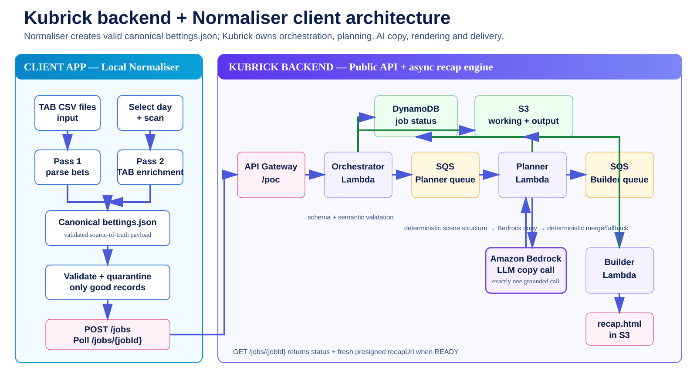

# TabAPIvbeta2 — Kubrick

## Architecture




`TabAPIvbeta2` is the active source repository for **Kubrick**, the TAB Daily Recap generation service.

Kubrick is the complete backend pipeline:

```text
Kubrick
  = Orchestrator Lambda
  + Planner Lambda
  + Builder / Renderer Lambda
```

The repository name is `TabAPIvbeta2`, while the deployed AWS resources intentionally retain their existing `tab-recap-vbeta1-*` names.

## Component terminology

- **Orchestrator** — owns the public API boundary, creates the job ID, stores canonical input, starts planning, exposes job status and returns the final recap URL.
- **Planner** — owns deterministic scene structure, one grounded LLM copy call and deterministic copy fallback, then produces `scene.json`.
- **Builder / Renderer** — renders `bettings.json + scene.json` into the final interactive `recap.html`.
- **Kubrick** — the complete Orchestrator + Planner + Builder/Renderer service.

The CSV **Normaliser is not part of Kubrick**. It is an isolated sample client/use case that converts TAB CSV data into canonical `bettings.json` and then consumes the Kubrick API. Any other client capable of producing canonical `bettings.json` can consume Kubrick directly.

## Authoritative documents

Read these first:

- `KUBRICK-ARCHITECTURE-GUIDE.md` — authoritative architecture, component ownership and locked planner policy.
- `docs/KUBRICK_API.md` — client-facing API contract and exact consumption flow.
- `docs/KUBRICK_V2_MIGRATION.md` — migration history, proof state and deployment rules.
- `docs/NORMALISER-LOGIC-SPEC.md` — isolated sample CSV client design.
- `tests/README.md` — current regression, fixture and API-test expectations.
- `tests/manual-cli-tests.md` — deployed-AWS smoke-test procedures and proof record.

## Public API

Kubrick exposes exactly two POC endpoints:

```text
POST /jobs
GET  /jobs/{jobId}
```

Both currently require the API Gateway `x-api-key` header. The shared POC API key value is deliberately not stored in this repository or documentation.

A client:

```text
canonical bettings.json
  -> POST /jobs
  -> receive jobId
  -> poll GET /jobs/{jobId}
  -> status becomes READY
  -> receive short-lived recapUrl
  -> open/download recap.html
```

The Orchestrator generates the UUID job ID. Clients do not create job IDs.

## Kubrick processing flow

```text
Client
  |
  | POST /jobs + x-api-key
  v
API Gateway
  |
  v
Orchestrator
  |
  +--> UUID jobId
  +--> S3 working/<jobId>/bettings.json
  +--> DynamoDB RECEIVED
  +--> Planning SQS
  |
  v
Planner
  |
  +--> deterministic scene structure
  +--> exactly one grounded Bedrock copy call
  +--> deterministic fallback if copy stage fails
  +--> scene.json
  +--> DynamoDB RENDERING
  +--> Rendering SQS
  |
  v
Builder / Renderer
  |
  +--> recaps/<jobId>/recap.html
  +--> DynamoDB READY + recapS3Key
  |
  | GET /jobs/{jobId}
  v
Orchestrator
  |
  +--> fresh short-lived presigned recapUrl
  v
Client
```

The LLM is a copywriter only. Code owns scene structure, grouping, chronology, coverage, replay selection, midpoint placement and duration.

There is no structural repair loop and no second LLM call.

## Current AWS environment

Account: `134387458447`  
Region: `ap-southeast-2`

Key resources:

- `tab-recap-vbeta1-orchestrator`
- `tab-recap-vbeta1-scene-planner`
- `tab-recap-vbeta1-builder-recap`
- `tab-recap-vbeta1-planning`
- `tab-recap-vbeta1-rendering`
- `tab-recap-vbeta1-jobs`
- `tab-recap-vbeta1`
- `tab-recap-vbeta1-api`

Deployment source branch remains `deploy`.

## Current proof state

The public API path is live-proven across multiple fixture sizes up to 75 bets:

```text
POST /jobs
-> Orchestrator
-> Planner
-> Rendering SQS
-> Builder / Renderer
-> READY
-> GET /jobs/{jobId}
-> recapUrl
-> working recap.html
```

The orchestrator harness exercises both public endpoints and downloads the final recap:

```cmd
tests\tools\run-orchestrator-test.cmd <size>
```

Supported fixture sizes are 5, 8, 16, 32, 50 and 75.

The soundtrack path is also live-proven after enabling CORS for the existing CloudFront MP3 path and setting `audio.crossOrigin='anonymous'` before assigning the soundtrack source.

## Reference repository

`rorygleeson/TabAPIvbeta1` remains the frozen migration reference/fallback source. It is not the active Kubrick codebase.
